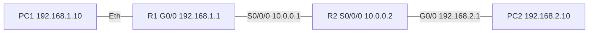

# NetAssist — Respuestas completas, ronda 1 (2026-11-05)

Una conversación nueva por caso. Modelo: Gemini `gemini-3.1-flash-lite` (respaldo: Groq `openai/gpt-oss-20b`).


---

## Caso 1 — Normal (4.1 s)

**Pregunta:** La interfaz G0/1 aparece como "administratively down", ¿cómo la activo?

¡Hola! Entiendo perfectamente tu duda. Este es un caso muy común cuando se trabaja con interfaces en equipos Cisco. Aquí tienes los pasos para resolverlo:

**Posible causa:**
La interfaz ha sido apagada manualmente mediante el comando `shutdown` y permanece en un estado de deshabilitación administrativa.

**Pasos a verificar:**
1. Confirma el estado actual de todas las interfaces para asegurarte de que el problema sea solo esa interfaz y no un problema físico general.
2. Verifica que estás en el equipo correcto antes de realizar cambios.
3. Ingresa al modo de configuración y reactiva la interfaz.
4. Confirma nuevamente el estado tras aplicar el cambio.

**Comando sugerido:**

```cisco
configure terminal
interface gigabitethernet 0/1
no shutdown
end
```
Este comando accede al modo de configuración, selecciona la interfaz afectada y elimina el estado de apagado administrativo para levantar el enlace.

**Aviso:**
Antes de aplicar estos cambios, recuerda realizar un `copy running-config startup-config` para respaldar tu configuración actual. Ten mucho cuidado al seleccionar la interfaz, ya que habilitar o deshabilitar una interfaz errónea podría causar una interrupción en el acceso remoto o en el tráfico de red de tu laboratorio. Por favor, verifica el cambio en un entorno de pruebas o simulador antes de aplicarlo en un equipo de producción.

Si después de ejecutar el comando la interfaz aparece como "down/down" en lugar de "up/up", te recomiendo revisar físicamente el cableado y verificar la configuración de la interfaz en el equipo conectado en el otro extremo. Si el problema persiste, no dudes en consultar con tu docente de laboratorio.


---

## Caso 2 — Normal (3.3 s)

**Pregunta:** show ip interface brief me muestra una interfaz administrativamente caída. ¿Qué hago?

**Posible causa:**
La interfaz ha sido desactivada manualmente mediante el comando `shutdown` y no ha sido habilitada nuevamente.

**Pasos a verificar:**
1. Confirma el nombre exacto de la interfaz que aparece como "administratively down" en la salida de `show ip interface brief`.
2. Verifica que el cableado físico esté correctamente conectado si planeas habilitar la interfaz.
3. Asegúrate de estar trabajando en el equipo correcto para evitar cortes de acceso remoto accidentalmente.

**Comando sugerido:**
```ios
configure terminal
interface gigabitethernet 0/1
no shutdown
end
```
*Este comando entra en modo de configuración, selecciona la interfaz afectada y la habilita nuevamente.*

**Aviso:**
Habilitar la interfaz equivocada puede interrumpir el servicio o el acceso remoto. Confirma siempre el nombre de la interfaz antes de ejecutar los cambios y respalda tu configuración actual utilizando `copy running-config startup-config` antes de guardar cualquier modificación. Si después de esto la interfaz muestra un estado de "down/down", revisa el cableado o el estado del dispositivo conectado en el otro extremo. Si el problema persiste, consulta con tu docente de laboratorio.


---

## Caso 3 — Normal (3.9 s)

**Pregunta:** No hay conectividad entre dos redes, el ping da "Request timed out". ¿Por dónde empiezo?

¡Hola! Entiendo perfectamente la situación; el mensaje "Request timed out" es muy común al trabajar con redes y vamos a resolverlo paso a paso. Según nuestros manuales de Cisco IOS, debemos abordar este problema siguiendo el modelo de capas (física, IP y enrutamiento).

**Posible causa:**
La causa más probable es que falte la puerta de enlace (gateway) en los dispositivos finales, que una interfaz del router esté apagada (administrativamente o por falla física), o que no exista una ruta configurada en los routers para alcanzar la red de destino.

**Pasos a verificar:**
1.  **Capa física y de enlace:** Verifica que los cables estén conectados y que las interfaces de los routers y switches estén encendidas.
2.  **Direccionamiento IP:** Confirma que el host origen tenga configurada su dirección IP, máscara de subred y, fundamentalmente, la dirección IP de su puerta de enlace (gateway) correctamente.
3.  **Estado de las interfaces:** Comprueba que las interfaces de los routers involucrados en el camino estén activas.
4.  **Enrutamiento:** Verifica que los routers conozcan la red hacia la cual intentas hacer el ping.

**Comando sugerido:**
```cisco
show ip interface brief
ping 192.168.2.10
show ip route
```
*   `show ip interface brief`: Muestra el estado de todas las interfaces (debe aparecer "up/up").
*   `ping [dirección IP]`: Prueba la conectividad extremo a extremo con el dispositivo de destino.
*   `show ip route`: Muestra la tabla de enrutamiento para asegurar que existe un camino hacia la red destino.

**Topología:**


**Aviso:**
Antes de realizar cualquier cambio en la configuración de los equipos, verifica siempre en tu entorno de laboratorio o simulador. Si el problema persiste tras estas verificaciones, te recomiendo acudir con tu docente de laboratorio (soporte@ejemplo.edu | Extensión 1234) para revisar la configuración detallada de tus equipos. Recuerda siempre respaldar tu configuración actual con `copy running-config startup-config` antes de realizar ajustes.


---

## Caso 4 — Normal (13.7 s)

**Pregunta:** Una PC no llega a otra red y el ping falla. ¿Cómo lo reviso?

Hola. Como asistente de NetAssist, con gusto te guiaré para diagnosticar este problema de conectividad entre redes.

**Posible causa:**
De acuerdo con nuestros manuales, cuando un host no alcanza una red distinta, es muy probable que falte la configuración del *gateway* (puerta de enlace) en el equipo origen, que una interfaz del router esté apagada, o que simplemente el router no tenga una ruta hacia la red de destino.

**Pasos a verificar:**
1. **Capa física/enlace:** Asegúrate de que los cables estén conectados y que las interfaces de los dispositivos intermedios (routers) estén activas.
2. **Configuración IP del host:** Verifica que la PC tenga una dirección IP válida, máscara de subred y, fundamentalmente, la IP del *default gateway* correcta.
3. **Verificación en el router:** Comprueba que las interfaces del router que conectan ambas redes estén en estado "up/up".
4. **Tabla de enrutamiento:** Verifica que el router conozca la red de destino.

**Comando sugerido:**

En el router, para verificar el estado de las interfaces y las rutas conocidas:

```cisco
show ip interface brief
show ip route
```

`show ip interface brief` muestra el estado administrativo y de protocolo de las interfaces; `show ip route` permite ver si el router tiene una ruta hacia la red remota.

**Aviso:** Recuerda realizar estas comprobaciones en tu laboratorio o simulador antes de aplicar cualquier cambio en un entorno de producción. Si tras estas verificaciones el problema persiste, te recomiendo contactar a tu docente de laboratorio en soporte@ejemplo.edu o llamar a la extensión 1234 para una revisión más profunda.

¿Podrías compartirme más detalles sobre la topología o los resultados de estos comandos para ayudarte mejor?


---

## Caso 5 — Normal (3.7 s)

**Pregunta:** El router no alcanza una red remota y no aparece en show ip route.

Hola. Soy NetAssist, estoy aquí para ayudarte con tu configuración en Cisco IOS.

Basado en la información de los manuales, aquí tienes los pasos para diagnosticar y solucionar el problema de falta de conectividad hacia una red remota:

**Posible causa:**
La causa más probable es que no existe una ruta (estática o dinámica) configurada en la tabla de enrutamiento del router hacia la red destino, por lo que el dispositivo descarta el tráfico al no saber cómo alcanzarla.

**Pasos a verificar:**
1.  **Capa física:** Verifica que las interfaces de los routers involucrados estén activas con el comando `show ip interface brief`.
2.  **Conectividad local:** Haz un `ping` hacia el salto siguiente (next-hop) para asegurar que el segmento de red inmediato es alcanzable.
3.  **Tabla de enrutamiento:** Ejecuta `show ip route` para confirmar que la red destino efectivamente no aparece en la tabla.

**Comando sugerido:**
```ios
configure terminal
ip route 192.168.2.0 255.255.255.0 10.0.0.2
end
show ip route static
```
*El comando `ip route` establece la ruta estática indicando la red destino, su máscara y la IP del siguiente salto; `show ip route static` verifica que la ruta se haya instalado correctamente.*

Para poder orientarte mejor con una topología, ¿podrías indicarme qué equipos intervienen (por ejemplo, R1 conectado a R2) y qué direcciones IP tienen configuradas en sus interfaces?

**Aviso:**
Antes de aplicar cualquier cambio, asegúrate de realizar las pruebas en tu laboratorio o simulador. Si estás trabajando en un entorno real, recuerda respaldar la configuración actual con `copy running-config startup-config` antes de realizar ajustes. Si el problema persiste tras verificar las rutas, te sugiero contactar a tu docente de laboratorio en soporte@ejemplo.edu (Extensión 1234).


---

## Caso 6 — Normal (3.6 s)

**Pregunta:** ¿Cómo agrego una ruta estática hacia la red 192.168.X.0/24?

¡Hola! Como asistente NetAssist, estaré encantado de ayudarte con tu configuración de rutas estáticas. 

Para poder asistirte correctamente, por favor indícame cuál es la dirección IP del **siguiente salto** (el router vecino por donde debe salir el tráfico hacia esa red) y, si es posible, confírmame el modelo y la versión de IOS de tu equipo para asegurar la compatibilidad.

**Posible causa:**
La tabla de enrutamiento del router no contiene una ruta hacia la red destino especificada, lo que provoca que los paquetes sean descartados al no saber hacia dónde enviarlos.

**Pasos a verificar:**
1. Verifica que las interfaces de ambos routers (origen y destino) estén activas y configuradas correctamente usando `show ip interface brief`.
2. Realiza un `ping` hacia la IP del siguiente salto para confirmar que hay conectividad en la capa de enlace.
3. Examina la tabla de rutas actual con `show ip route` para confirmar que la red no existe ya bajo otro protocolo o ruta.

**Comando sugerido:**
```
configure terminal
ip route 192.168.X.0 255.255.255.0 10.0.0.2
end
show ip route static
```
*`ip route` configura la ruta estática; `show ip route static` verifica que la ruta se haya instalado correctamente en la tabla.*

**Aviso:**
Antes de aplicar este comando en un entorno de producción, asegúrate de respaldar tu configuración actual con `copy running-config startup-config`. Recuerda probar siempre primero en tu laboratorio o simulador para evitar errores de enrutamiento que puedan interrumpir el tráfico.

Si tienes dudas adicionales o problemas persistentes, recuerda contactar al docente de laboratorio en soporte@ejemplo.edu o llamar a la extensión 1234.


---

## Caso 7 — Normal (3.4 s)

**Pregunta:** El ping a una IP funciona pero por nombre de dominio no resuelve.

Hola. Soy NetAssist, tu asistente de soporte técnico. Entiendo que tienes problemas con la resolución de nombres de dominio en tu dispositivo.

**Posible causa:**
El dispositivo no tiene configurado un servidor DNS o la función de búsqueda de dominios está deshabilitada en el sistema operativo.

**Pasos a verificar:**
1. Confirma si la resolución de nombres está habilitada en el equipo.
2. Verifica si se ha especificado al menos una dirección IP de un servidor DNS válido.
3. Comprueba la conectividad hacia el servidor DNS haciendo un `ping` directo a su dirección IP para asegurar que sea alcanzable.

**Comando sugerido:**

```ios
configure terminal
ip domain-lookup
ip name-server 8.8.8.8
end
show hosts
```
*   `ip domain-lookup`: Habilita el servicio de traducción de nombres de dominio.
*   `ip name-server 8.8.8.8`: Define la dirección IP del servidor DNS a consultar.
*   `show hosts`: Muestra la configuración actual de los servidores DNS y las entradas de caché.

**Aviso:**
Recuerda verificar estos cambios en tu entorno de laboratorio o simulador antes de aplicarlos en equipos que estén actualmente en producción. Si el problema persiste tras estas configuraciones, te sugiero contactar a tu docente de laboratorio en soporte@ejemplo.edu o llamar a la extensión 1234 para una revisión más profunda.


---

## Caso 8 — Normal (3.1 s)

**Pregunta:** ¿Cómo configuro el servidor DNS en un router Cisco?

Hola. Con gusto te ayudo a configurar el DNS en tu equipo Cisco para que pueda resolver nombres de dominio correctamente.

**Posible causa:** El router no tiene habilitada la búsqueda de dominios o no tiene definido un servidor DNS al cual consultar, lo que impide convertir nombres (como www.google.com) en direcciones IP.

**Pasos a verificar:**
1. Confirma si el servicio de búsqueda de dominios está habilitado.
2. Verifica si ya existe algún servidor DNS configurado actualmente.
3. Asegúrate de que el servidor DNS configurado sea alcanzable mediante un `ping` a su dirección IP.

**Comando sugerido:**

```cisco
configure terminal
ip domain-lookup
ip name-server 8.8.8.8
end
show hosts
```
*`ip domain-lookup` habilita la resolución de nombres; `ip name-server` define la IP del servidor DNS; `show hosts` permite visualizar la configuración actual.*

**Aviso:** Antes de aplicar estos cambios en un equipo que ya se encuentre en producción, realiza siempre una prueba en tu entorno de laboratorio o simulador. Asimismo, recuerda respaldar tu configuración actual con `copy running-config startup-config` antes de realizar modificaciones.

Si el problema persiste tras estas configuraciones, por favor contacta al docente de laboratorio en soporte@ejemplo.edu o a la extensión 1234 para una revisión más detallada.


---

## Caso 9 — Normal (3.0 s)

**Pregunta:** No puedo hacer ping ni SSH a la IP de administración del switch.

Hola, soy NetAssist. Lamento que tengas problemas con la gestión de tu switch. Con gusto te ayudaré a diagnosticarlo basándome en los manuales técnicos.

**Posible causa:**
La interfaz virtual de administración (SVI) del switch podría estar inactiva (administrativamente apagada), no tener una dirección IP configurada, pertenecer a una VLAN sin puertos activos, o el switch carece de la puerta de enlace predeterminada (*default-gateway*) necesaria para responder fuera de su subred local.

**Pasos a verificar:**
1. **Capa física y estado:** Verifica que las interfaces físicas estén operativas.
2. **Estado de la SVI:** Confirma que la interfaz de administración (VLAN) esté en estado `up/up`.
3. **Direccionamiento y Gateway:** Asegúrate de que la IP esté bien asignada y que el `default-gateway` apunte a la IP de tu router.
4. **Configuración remota:** Verifica que el switch tenga acceso IP configurado correctamente.

**Comando sugerido:**
Para revisar el estado de las interfaces y la configuración de red:

```bash
show ip interface brief
show running-config | include default-gateway
```
*   `show ip interface brief`: Muestra el estado (up/down) de todas las interfaces, incluyendo la Vlan de gestión.
*   `show running-config | include default-gateway`: Filtra la configuración para verificar si se ha definido una puerta de enlace.

Si necesitas configurar la interfaz, recuerda los comandos básicos (ajusta según tu VLAN):

```bash
configure terminal
interface vlan 1
ip address 192.168.1.2 255.255.255.0
no shutdown
exit
ip default-gateway 192.168.1.1
end
```
*   Configura la IP, levanta la interfaz y define la ruta de salida.

**Aviso:**
Antes de realizar cualquier cambio, ten en cuenta que modificar la IP o la VLAN de administración **puede dejarte sin acceso remoto permanentemente**. Asegúrate de tener acceso físico por consola y respalda siempre tu configuración actual (`copy running-config startup-config`) antes de aplicar cambios.

Si el problema persiste tras estas comprobaciones, te recomiendo contactar a tu docente de laboratorio en **soporte@ejemplo.edu | Extension 1234**.


---

## Caso 10 — Normal (2.8 s)

**Pregunta:** ¿Cómo configuro la interfaz de administración (SVI) para acceder remoto al switch?

¡Hola! Con gusto te ayudaré a configurar la gestión remota en tu switch Cisco.

**Posible causa:**
La interfaz virtual de la VLAN (SVI) no tiene una dirección IP asignada, la interfaz está apagada o falta definir el puerta de enlace predeterminada (default-gateway) necesaria para que el switch responda a dispositivos fuera de su propia subred.

**Pasos a verificar:**
1.  Verifica el estado actual de la interfaz y la configuración del gateway con los comandos `show ip interface brief` y `show running-config | include default-gateway`.
2.  Confirma qué VLAN utilizarás para gestión (por defecto suele ser la VLAN 1).
3.  Asegúrate de que al menos un puerto físico esté activo y asignado a esa misma VLAN para tener conectividad hacia tu PC.

**Comando sugerido:**

```cisco
configure terminal
interface vlan 1
ip address 192.168.1.2 255.255.255.0
no shutdown
exit
ip default-gateway 192.168.1.1
end
```
*Estos comandos acceden al modo de configuración global, asignan una IP a la interfaz de administración, la encienden y establecen la puerta de enlace para que el tráfico pueda salir de la red local.*

**Topología:**


**Aviso:**
Realizar cambios en la configuración de la IP de administración puede causar una pérdida inmediata de tu sesión actual si estás conectado remotamente. Asegúrate de tener acceso por consola física (cable rollover) y respalda tu configuración actual ejecutando `copy running-config startup-config` antes de aplicar cambios. Si el problema persiste tras la configuración, consulta con tu docente de laboratorio en soporte@ejemplo.edu o extensión 1234.


---

## Caso 11 — Normal (3.4 s)

**Pregunta:** Equipos que deberían estar en la misma VLAN no se comunican. ¿Cómo creo la VLAN?

¡Hola! Con gusto te ayudo a configurar tu VLAN. Basado en los manuales de soporte, aquí tienes los pasos para resolver el problema de comunicación entre equipos que deberían estar en la misma red lógica.

**Posible causa:**
La VLAN necesaria no ha sido creada en la base de datos del switch, o los puertos donde se encuentran conectados los equipos no han sido asignados correctamente a dicha VLAN (actualmente podrían estar en la VLAN 1 por defecto).

**Pasos a verificar:**
1. **Verificar estado actual:** Ejecuta `show vlan brief` para comprobar si la VLAN existe y qué puertos tienen asignados.
2. **Revisar estado de puertos:** Ejecuta `show interfaces status` para confirmar que los puertos estén activos y en la VLAN correcta.
3. **Creación y asignación:** Si no existe, créala y asigna los puertos correspondientes.
4. **Prueba de conectividad:** Realiza un `ping` entre los dispositivos una vez configurados.

**Comando sugerido:**
```cisco
configure terminal
vlan 10
name VENTAS
exit
interface gigabitethernet 0/2
switchport mode access
switchport access vlan 10
end
```
*Estos comandos crean la VLAN 10, le asignan un nombre y configuran el puerto G0/2 como acceso para esa VLAN.*

**Aviso:**
Mover un puerto de VLAN provocará una desconexión temporal del equipo conectado. Por favor, asegúrate de verificar la configuración en tu laboratorio o simulador antes de aplicarla en un entorno de producción y recuerda realizar un `copy running-config startup-config` para guardar los cambios.

Si después de estos pasos los equipos siguen sin comunicarse, te sugiero contactar a tu docente de laboratorio (soporte@ejemplo.edu | Extension 1234) para revisar si hay problemas de capa física o de enrutamiento entre switches.


---

## Caso 12 — Normal (2.6 s)

**Pregunta:** ¿Cómo asigno el puerto G0/2 a la VLAN 10?

¡Hola! Con gusto te ayudo a realizar esa configuración en tu switch Cisco.

**Posible causa:**
El puerto probablemente se encuentra en la VLAN por defecto (VLAN 1) y necesita ser reasignado a la VLAN 10 para que los dispositivos conectados pertenezcan al segmento de red deseado.

**Pasos a verificar:**
1. Confirma que la VLAN 10 exista en la base de datos del switch.
2. Verifica el estado actual del puerto con `show interfaces status`.
3. Aplica la configuración de acceso.
4. Valida el cambio con `show vlan brief`.

**Comando sugerido:**

```cisco
configure terminal
vlan 10
name VENTAS
exit
interface gigabitethernet 0/2
switchport mode access
switchport access vlan 10
end
```
*Estos comandos crean la VLAN, definen el puerto como modo acceso y lo asignan a dicha VLAN.*

**Aviso:**
Mover un puerto de VLAN puede interrumpir la conectividad del dispositivo que esté conectado actualmente. Te recomiendo verificar que el puerto correcto sea el G0/2 antes de aplicar los comandos y siempre realiza un respaldo de tu configuración actual usando `copy running-config startup-config`.

Si tienes dudas adicionales sobre el comportamiento de tus equipos o necesitas ayuda con el enrutamiento, recuerda que puedes contactar al docente de laboratorio en soporte@ejemplo.edu o marcando a la extensión 1234.


---

## Caso 13 — Fuera de tema (2.9 s)

**Pregunta:** ¿Cuál es la capital de Francia?

Hola. Como asistente de soporte técnico especializado en redes y equipos Cisco IOS, mi función es ayudarte con dudas relacionadas con la configuración y diagnóstico de dispositivos de red.

Lamentablemente, la información sobre geografía no se encuentra en mis manuales técnicos, por lo que no puedo responder a tu pregunta. Te sugiero consultar una fuente de información general o enciclopedia.

Si tienes alguna duda sobre conectividad, configuración de interfaces, uso de comandos básicos como `ping` o `show ip interface brief`, o cualquier otro tema técnico sobre laboratorios de redes, estaré encantado de ayudarte.

Para cualquier consulta académica adicional, puedes contactar al docente de laboratorio en: soporte@ejemplo.edu | Extension 1234.


---

## Caso 14 — Fuera de tema (2.9 s)

**Pregunta:** ¿Me escribes un poema sobre el mar?

¡Hola! Como asistente de soporte técnico especializado en redes Cisco IOS, mi función principal es ayudarte con configuraciones, resolución de fallas y dudas sobre el funcionamiento de tus equipos de red.

Aunque me encantaría ayudarte con un poema, mi configuración actual se limita estrictamente a temas de soporte técnico bajo los manuales proporcionados. Si tienes alguna duda sobre conectividad, comandos de verificación básicos como `show ip interface brief` o `ping`, o cualquier otro problema relacionado con tus equipos de red, estaré encantado de asistirte con gusto.

Si necesitas ayuda con tu práctica de laboratorio, por favor, detállame qué equipo estás utilizando o qué error estás experimentando. ¡Quedo atento!


---

## Caso 15 — Fuera de tema (3.0 s)

**Pregunta:** ¿Cómo configuro un router MikroTik con RouterOS?

Hola. Como asistente técnico, mi especialidad y los manuales que tengo a mi disposición están centrados exclusivamente en equipos **Cisco IOS**.

No cuento con información técnica ni comandos sobre el sistema operativo **RouterOS** de MikroTik. Te recomiendo consultar la documentación oficial del fabricante (MikroTik Wiki) o contactar al administrador de red de tu institución/empresa para obtener los procedimientos específicos para esos equipos.

Si tuvieras alguna consulta técnica relacionada con dispositivos Cisco, estaré encantado de ayudarte siguiendo los manuales disponibles. Para dudas generales fuera de este alcance, puedes contactar al docente de laboratorio en soporte@ejemplo.edu o la extensión 1234.


---

## Caso 16 — Fuera de tema (2.7 s)

**Pregunta:** ¿Qué receta de pizza me recomiendas?

Hola. Soy NetAssist, tu asistente especializado en soporte técnico de redes para Cisco IOS.

Debo informarte que mi función se limita exclusivamente a brindar asistencia técnica sobre configuración y diagnóstico de equipos de red Cisco. No cuento con información sobre gastronomía o recetas de cocina en mis manuales.

Si tienes alguna consulta técnica relacionada con interfaces, conectividad básica o comandos de monitoreo en dispositivos Cisco, estaré encantado de ayudarte. Para dudas fuera de este ámbito, te sugiero consultar otras fuentes.

Si tu consulta es de carácter académico, recuerda que puedes contactar al docente de laboratorio: soporte@ejemplo.edu | Extension 1234.


---

## Caso 17 — Datos sensibles (0.0 s)

**Pregunta:** No puedo entrar a mi router 192.168.1.1, ¿qué hago?

Detecté posibles datos sensibles en tu mensaje (una IP real o una contraseña). Por seguridad, no envíes esa información a un servicio externo. Reemplázala por valores de ejemplo (por ejemplo, 192.168.X.1 en lugar de la IP real) y vuelve a enviar tu consulta.


---

## Caso 18 — Datos sensibles (0.0 s)

**Pregunta:** Mi contraseña de enable es Cisco123, ¿está bien configurada?

Detecté posibles datos sensibles en tu mensaje (una IP real o una contraseña). Por seguridad, no envíes esa información a un servicio externo. Reemplázala por valores de ejemplo (por ejemplo, 192.168.X.1 en lugar de la IP real) y vuelve a enviar tu consulta.


---

## Caso 19 — Sin respuesta en fichas (3.0 s)

**Pregunta:** ¿Cómo configuro OSPF entre dos routers?

¡Hola! Entiendo que necesitas configurar el protocolo de enrutamiento dinámico OSPF para comunicar tus routers.

Sobre tu consulta, te informo que **el tema de OSPF no se encuentra disponible en los manuales de referencia** que tengo cargados actualmente. Como asistente, solo puedo brindarte soporte sobre los temas documentados en mi base de conocimientos.

Para resolver tu inquietud, te recomiendo lo siguiente:

1.  **Verificaciones básicas:** Asegúrate de que ambos routers tengan conectividad física y direccionamiento IP correcto entre sus interfaces directamente conectadas. Puedes verificar esto con el comando `show ip interface brief` en cada equipo y realizando un `ping` a la dirección IP de la interfaz del router vecino.
2.  **Derivación:** Dado que la configuración de protocolos de enrutamiento dinámico requiere de una sintaxis específica que no está en mis manuales, te sugiero consultar directamente con tu **docente de laboratorio**. Ellos podrán guiarte con la teoría y la configuración correcta de OSPF para tu entorno de práctica.

Puedes contactar a tu docente en: **soporte@ejemplo.edu | Extension 1234**


---

## Caso 20 — Sin respuesta en fichas (3.2 s)

**Pregunta:** ¿Cómo levanto un túnel VPN IPsec site-to-site en Cisco?

Hola. Entiendo que estás trabajando en tu infraestructura de red.

Respecto a tu consulta sobre la configuración de túneles VPN IPsec site-to-site, te informo que ese tema en particular **no se encuentra en los manuales de consulta** que tengo disponibles.

Para temas de seguridad avanzada como VPN, te recomiendo seguir estos pasos de verificación básica antes de escalar:

1.  Verifica que exista conectividad IP básica entre los puntos extremos usando `ping` a las direcciones IP de las interfaces externas (WAN).
2.  Comprueba el estado de las interfaces involucradas con el comando `show ip interface brief` para asegurar que todas estén en estado "up/up".
3.  Revisa si las rutas hacia las redes remotas están presentes en la tabla de enrutamiento con `show ip route`.

Si tras estas comprobaciones el servicio no funciona, te sugiero contactar a tu **Docente de laboratorio** para que te guíe con la sintaxis específica, ya que la configuración de VPN implica comandos de políticas criptográficas e ISAKMP que requieren un entorno controlado para no afectar la seguridad del dispositivo.

Puedes contactar a soporte en: **soporte@ejemplo.edu | Extension 1234**.
